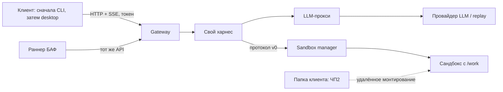

# Архитектура: рабочее предложение

Статус: сервер, sandbox API и агентный цикл CP1-05 реализованы. Клиентский gateway и CLI реализованы в CP1-06; раннер 15 задач Б1–Б5 реализован; [текущие границы харнеса](harness.md). Первые решения — [ADR](adr/README.md).

- **Gateway** проверяет клиентский токен, владеет публичными сессиями и отдаёт поток событий. Не исполняет команды.
- **Харнес** собирает контекст, вызывает модель, проверяет tool calls, передаёт операции sandbox-manager и возвращает наблюдения модели. У цикла есть лимиты шагов и времени.
- **Sandbox-manager** управляет жизненным циклом изолированной среды. Только он получает доступ к механизму запуска контейнеров. Произвольные команды выполняются внутри сандбокса.
- **Сандбокс** содержит инструменты и `/work`, но не серверные ключи, Docker socket и исходники управляющих сервисов.
- **LLM-прокси** отделяет провайдера и ключ от остальных компонентов, нормализует ответы и usage. Для CI использует replay/mock.
- **Клиент** сначала даёт проверяемое CLI-подключение. Десктоп-оболочка остаётся обязательной частью итогового проекта; CLI не заменяет весь A-2.
- **Раннер БАФ** готовит чистую фикстуру, запускает задачу через штатный API, собирает итоговую папку, вызывает доверенный чекер вне агентской среды, сохраняет результат и освобождает ресурсы.

## Первый сквозной сценарий

Клиент отправляет задачу → gateway создаёт запуск → харнес получает tool call модели → manager исполняет команду в сандбоксе → stdout/stderr/exit code возвращаются харнесу → модель продолжает или завершает работу → клиент видит события и итог. JSONL связывает всё через trace_id, session_id, run_id и operation_id.

Первые проходы проверяются replay-ответами. Затем подключается реальная разрешённая модель. Прямое выполнение команд в контейнере харнеса нарушило бы A-4.1, даже если сам харнес запущен в Docker.

## Границы ЧП1

Предлагаем Python для серверных компонентов и CLI; конкретные библиотеки и версии закрепляются в CP1-03. Не вводим БД, очереди, RAG и мультиагентность без необходимости. Для v0 предлагаем одну активную задачу на сессию и отдельный контейнер на сессию. Restart сервиса может завершать сессию ошибкой — это явно документируется, не обещаем durability без реализации.

В ЧП1 `/work` — временная тестовая рабочая папка с фикстурой. В ЧП2 источник `/work` заменяется настоящим удалённым mount. Интерфейс provision должен иметь описание источника workdir и режима ro/rw; копирование файлов не выдаём за mount.

Управляющий API manager закрыт от клиента; image, host path и Docker options выбирает сервер по allowlist. Модель не передаёт произвольные параметры Docker. Базовые ограничения вводятся при первом сандбоксе, полная матрица hardening и fault tests — к ЧП2.
